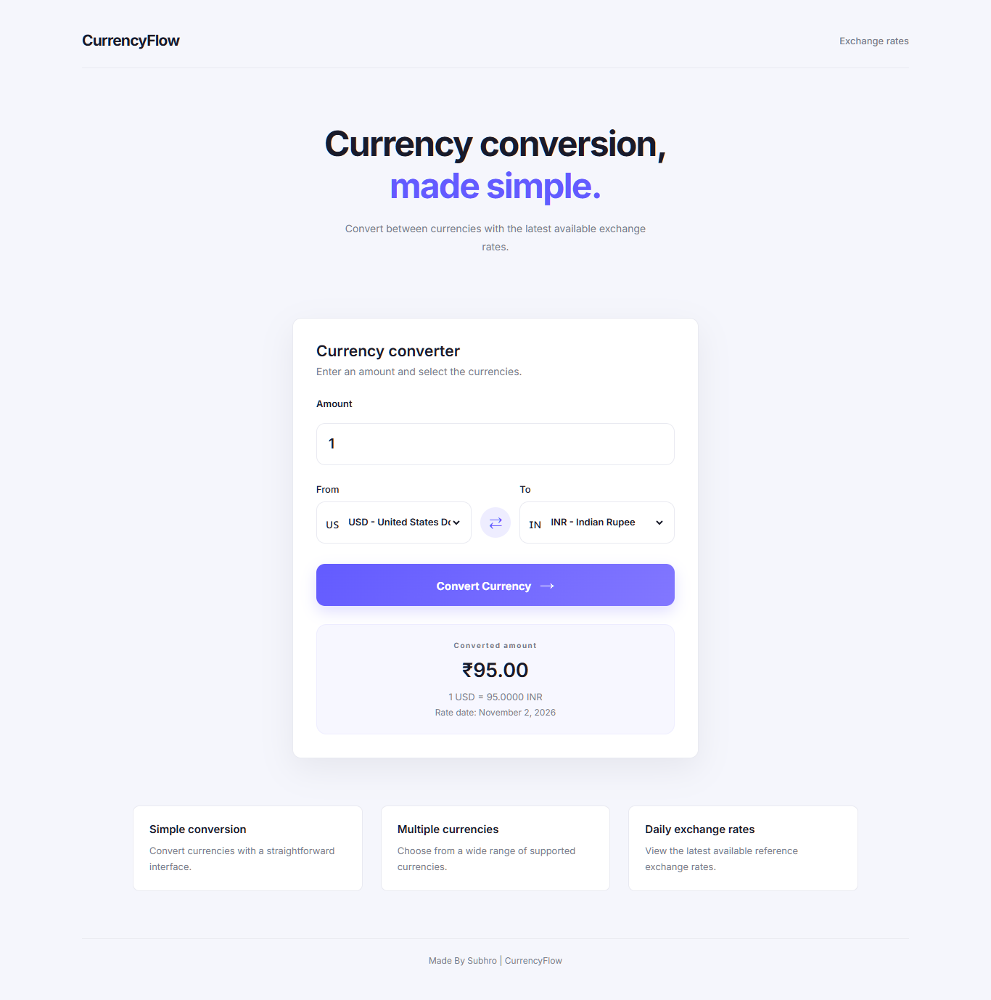

# Universal Currency Converter

A simple, responsive and user-friendly currency converter built with HTML, CSS and Vanilla JavaScript. It allows users to convert between multiple currencies using exchange rate data provided by the Frankfurter API.

## Overview

Universal Currency Converter is a lightweight web application designed to make currency conversion simple and accessible.

Users can enter an amount, select source and target currencies, swap currencies and view the converted amount along with the available exchange rate information.

The application uses the Frankfurter API, which provides exchange rate data based on reference rates published by central banks.

## Features

- Convert between multiple supported currencies.
- Automatically load available currencies from the API.
- Select source and target currencies.
- Swap selected currencies instantly.
- Display country flags for supported currencies.
- Show the converted amount.
- Display the exchange rate and rate date.
- Responsive design for desktop, tablet and mobile.
- Input validation and error handling.
- No API key required.

## Technologies Used

| Technology | Purpose |
|---|---|
| HTML5 | Application structure |
| CSS3 | Styling and responsive layout |
| Vanilla JavaScript | Application logic and API integration |
| Frankfurter API | Currency and exchange rate data |

